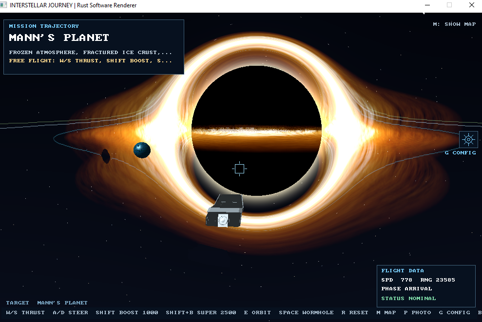

# Interstellar Journey — Rust Software Renderer

Adaptación en Rust de la película **Interstellar Journey**. La experiencia sigue el recorrido espacial de la película mediante un renderizador por software construido en el propio proyecto.


## Qué incluye

- Menú principal con selección por teclado: **Exploración**, **Historia**, **Niveles** y **Configuración**. El engranaje del HUD o la tecla `G` abre la configuración durante el vuelo.
- Vuelo libre en tercera persona con aceleración, frenado, giro y cabeceo progresivos, calculados por tiempo transcurrido para mantener una respuesta coherente entre equipos.
- Planetas, Sol y agujero de gusano en escala visual `PLANET_SCALE = 15.0`; Gargantúa usa una escala propia para que el borde del disco quede a 1,600 unidades de juego de la órbita de Miller. Las naves importadas se normalizan a una escala compacta para conservar la maniobrabilidad.
- Distancias orbitales con `1 UA = 30,000` unidades de juego. Se mantiene la proporción aproximada de las órbitas reales y hay más separación física entre las superficies de los planetas.
- Los ocho planetas del Sistema Solar: Mercurio, Venus, Tierra, Marte, Júpiter, Saturno, Urano y Neptuno, cada uno con material procedural propio.
- Movimiento orbital continuo: la Tierra completa una vuelta en 5 minutos simulados y los demás planetas siguen periodos proporcionales a sus radios orbitales mediante la tercera ley de Kepler. La Luna orbita la Tierra y Miller, Mann y Edmund orbitan Gargantúa.
- Minimapa ocultable en la esquina superior derecha, con posición de la nave, cuerpos principales y órbitas. Cambia al mapa del sistema de Gargantúa después de cruzar el agujero de gusano.
- Recorrido por el Sistema Solar completo, con el cinturón de asteroides entre Marte y Júpiter y el agujero de gusano anclado junto a Saturno.
- Agujero de gusano que habilita el sistema de Gargantúa.
- Gargantúa, acoplamiento, Miller, Mann y Edmund.
- Gravedad estilizada de planetas, Sol y Gargantúa que curva continuamente el vector de velocidad.
- Cuerpos celestes intangibles: un detector predictivo desvía la nave antes del contacto y mantiene una distancia mínima para rodearlos.
- Asistencia de órbita con `E`, disponible al acercarse a un planeta o estrella; acompaña el vuelo con una trayectoria tangencial y se desactiva pulsando `E` otra vez.
- Detección predictiva que aplica una maniobra tangencial antes de entrar en el volumen de seguridad de cualquier planeta, la Luna, el Sol o Gargantúa. La nave mantiene el vuelo continuo y rodea los cuerpos celestes.
- Gravedad central estilizada para cada cuerpo masivo, integrada en la velocidad de la nave y combinada con evitación de obstáculos.
- Planetas con patrones procedurales; los únicos anillos visibles quedan en Saturno y Gargantúa. La Tierra, el Sol, Urano y el agujero de gusano se muestran sin aros.
- Efecto warp radial de velocidad: muy tenue con Shift y pronunciado al combinar Shift+B.
- HUD dibujado en el framebuffer, con engranaje de configuración accesible con clic o `G`.
- Pantalla de configuración con controles para música, diálogos, efectos y seis capas de shaders. Es un esqueleto de interfaz/estado: las opciones aún no activan ni desactivan esos sistemas.
- Guardado de capturas BMP con `P`.
- Importador OBJ de posiciones, coordenadas UV, normales y caras poligonales trianguladas. Los modelos GLB adjuntos se incluyen como OBJ optimizados para el renderizador por software.

## Requisitos

- Rust y Cargo (edición 2021).
- Un entorno de escritorio compatible con `minifb`.

## Ejecutar

Desde la raíz del proyecto:

```bash
cargo run --release
```

Para probar otro modelo OBJ como geometría base de los planetas:

```bash
cargo run --release -- --obj ruta/al/modelo.obj
```

### Iniciar directamente en un lugar

`--place` abre Exploración sin pasar por el menú. La nave aparece en el lado del cuerpo que mira hacia la estrella central (o hacia Gargantúa en el segundo sistema), orientada hacia el objeto:

```bash
cargo run --release -- --place earth
cargo run --release -- --place moon
cargo run --release -- --place gargantua
cargo run --release -- --place endurance
cargo run --release -- --place galaxy2-top
cargo run --release -- --place galaxy2-side
cargo run --release -- --place galaxy1-top
cargo run --release -- --place galaxy1-side
```

También se aceptan `--place=earth` y la forma compacta `--place[earth]`. Los destinos individuales son `mercury`, `venus`, `earth`, `moon`, `mars`, `jupiter`, `saturn`, `uranus`, `neptune`, `miller`, `mann`, `edmund`, `sun`, `wormhole`, `gargantua` y `endurance`. También se reconocen nombres en español como `tierra`, `luna`, `sol` y `agujero-de-gusano`. Las vistas de galaxia encuadran el sistema completo con el Sol o Gargantúa en el centro.

### Fotografías del framebuffer

`--foto` renderiza directamente el framebuffer y guarda BMP en `captures/`, sin abrir una ventana. Acepta un destino, varios separados por coma o punto y coma, o `all` para generar la colección completa:

```bash
cargo run --release -- --foto earth
cargo run --release -- --foto=mercury,venus,earth,moon,sun
cargo run --release -- --foto all
cargo run --release -- --foto galaxy1-top,galaxy1-side,galaxy2-top,galaxy2-side
cargo run --release -- --foto all --shader-layer 1
cargo run --release -- --foto
```

La capa de shader predeterminada es la 1. `--shader-layer 1..6` (o `--layer 1..6`) acepta todas las seis posiciones; las capas 2 a 6 quedan reservadas y, hasta que se implementen, renderizan con el pipeline base de la capa 1. Los archivos incluyen el destino, la capa y una marca de tiempo en el nombre.

El proyecto incluye `assets/models/esfera.obj`, convertido desde `esfera.glb`, y OBJ optimizados de los modelos GLB de la nave, Gargantúa, Endurance y el asteroide. Se conservan también los GLB originales. Para regenerar las versiones OBJ se puede ejecutar `python tools/convert_glb_assets.py` (requiere `trimesh`, `numpy` y `scipy`); el juego no necesita esas bibliotecas en tiempo de ejecución.

## Sistema Solar y escala orbital (v6)

Los radios de los planetas y de los principales objetos celestes usan `PLANET_SCALE = 15.0` respecto de los valores base. La escala lineal de las órbitas usa `1 UA = 30,000` unidades del mundo del juego, manteniendo las proporciones orbitales aproximadas y dejando espacio suficiente entre superficies.

| Cuerpo | Distancia media al Sol | Radio orbital en el juego |
|---|---:|---:|
| Mercurio | 0.387 UA | 11,610 |
| Venus | 0.723 UA | 21,690 |
| Tierra | 1.000 UA | 30,000 |
| Marte | 1.524 UA | 45,720 |
| Cinturón (centro) | 2.700 UA | 81,000 |
| Júpiter | 5.203 UA | 156,090 |
| Saturno | 9.537 UA | 286,110 |
| Urano | 19.191 UA | 575,730 |
| Neptuno | 30.069 UA | 902,070 |

No se pretende que los tamaños físicos y las distancias estén a la misma escala kilométrica: los cuerpos siguen siendo deliberadamente gigantes. Lo que se conserva es la proporción aproximada de las distancias orbitales, de modo que los planetas interiores quedan cerca y los exteriores mucho más separados.

### Periodos orbitales

La Tierra tarda exactamente 300 segundos de simulación (5 minutos) por revolución. Los demás periodos se calculan con `P = 300 * a^(3/2)`, donde `a` es la distancia media al Sol expresada en UA. Esto aplica la relación de Kepler para mantener proporciones consistentes.

| Cuerpo | Periodo en el juego |
|---|---:|
| Mercurio | 72 s (1.20 min) |
| Venus | 184 s (3.07 min) |
| Tierra | 300 s (5 min) |
| Marte | 564 s (9.41 min) |
| Júpiter | 3,560 s (59.3 min) |
| Saturno | 8,836 s (147 min) |
| Urano | 25,221 s (7.01 h) |
| Neptuno | 49,465 s (13.74 h) |
| Luna | 22.44 s por vuelta alrededor de la Tierra |

Los planetas describen órbitas circulares en el plano XZ. La excentricidad, inclinación y perturbaciones gravitatorias reales no se simulan; se prioriza una animación comprensible y estable para el curso. Miller, Mann y Edmund mantienen órbitas circulares estilizadas alrededor de Gargantúa.

Los valores de referencia se basan en las distancias medias y periodos orbitales de la ficha de datos planetarios de NASA Goddard. Se usan como proporciones de juego, no como efemérides. [NASA — Planetary Fact Sheet](https://nssdc.gsfc.nasa.gov/planetary/factsheet/).

### Cinturón de asteroides

El cinturón ocupa la región entre 2.1 y 3.3 UA del Sol con 900 rocas individuales. Cada roca usa la geometría del modelo `Asteroid.glb` y recibe variaciones de escala en sus tres ejes: predominan los fragmentos pequeños, con grupos medianos y algunos asteroides mucho mayores. Las rocas siguen órbitas independientes y ya no se dibujan círculos guía que formen un anillo sólido.

### Agujero de gusano, naves y boosts

El agujero de gusano está anclado a Saturno con un desplazamiento local fijo, fuera del límite exterior de sus anillos ampliados. Se renderiza como una sola esfera luminosa, sin aros externos.

Durante el recorrido del Sistema Solar se usa `endurance + ranger + ranger.glb`. Después de cruzar el agujero de gusano, la nave cambia al modelo `ranger_ship_of_interstellar_free.glb`. El objeto `endurance + ranger.glb` reemplaza el aro procedural del punto de acoplamiento. Gargantúa usa el disco dorado de 22 capas y el horizonte/lente se generan en el renderizador; `blackhole.obj` se conserva como alternativa si falta el disco nuevo.

`W + Shift` activa el boost normal con un límite de 1000 unidades/s. `W + Shift + B` activa el superboost con un límite de 2500 unidades/s. La tecla `B` sola no lo activa. El efecto warp radial se mantiene y el HUD muestra el nuevo límite.

### Cámara y minimapa

El alcance de proyección cubre el sistema completo. La cámara de persecución sigue el morro de la nave y existen cámaras panorámicas superiores y laterales para los dos sistemas; ambas mantienen al Sol o Gargantúa centrados. El minimapa muestra los ocho planetas, la Luna, el cinturón, el agujero de gusano y la posición actual de la nave.

## Escala, modelos importados y Gargantúa (v6 + actualización visual)

- `PLANET_SCALE = 15.0`: escala los radios base de los planetas, Sol y agujero de gusano. Gargantúa usa `GARGANTUA_DISK_RADIUS` para mantener la separación solicitada frente a la órbita de Miller.
- `AU_SCALE = 30,000`: amplía las distancias orbitales junto al tamaño de los cuerpos. Se conserva la relación de distancias orbitales de los ocho planetas.
- La nave inicia en el corredor libre entre la Tierra y Venus para no aparecer dentro de la Tierra ampliada.
- La órbita de la Luna se amplió a 6,500 unidades para mantener separación respecto de la superficie terrestre ampliada.
- El agujero de gusano acompaña a Saturno con un desplazamiento de 18,000 unidades en X y 3,900 en Y, fuera de sus anillos.
- Los planetas del sistema de Gargantúa se separaron mucho más: Miller 85,000, Mann 155,000 y Edmund 235,000 unidades de radio orbital.
- La salida del agujero de gusano queda a 275,000 unidades de Gargantúa, ligeramente fuera de la órbita de Edmund, para permitir un recorrido de aproximación hacia el centro.
- Gargantúa usa el disco dorado de 22 capas de `assets/blackhole_dorado/disco_capas.obj`, con sus texturas RGBA y conversión sRGB a luz lineal durante el muestreo. El radio exterior del disco es de 83,400 unidades de juego y conserva 1,600 unidades hasta la órbita interior de Miller (85,000). El horizonte se representa en pantalla y conserva el radio de 35,445 unidades.
- El plano lejano de la cámara es de 3,000,000 unidades; las estrellas de fondo se colocan a 1,300,000. Las vistas globales amplían el culling hasta 2,900,000 unidades para incluir el Sistema Solar completo.

## Gargantúa: disco dorado y lente gravitacional

El disco se renderiza con las 22 capas del OBJ preparado en Blender y las texturas `disco_centro`, `disco_medio` y `disco_borde`. El eje Z del archivo se transforma al eje Y del mundo del juego. Cada capa usa el canal alpha como máscara, mezcla aditiva en luz lineal y test de profundidad contra planetas y nave, sin escribir en el Z-buffer. Los archivos `.rgba` son copias RGBA sin compresión de los PNG y se incluyen en el ejecutable para no añadir una dependencia de decodificación de imágenes en tiempo de ejecución.

Al terminar la escena, el postprocesado proyecta Gargantúa a pantalla, calcula el radio aparente del horizonte y procesa solo su caja delimitadora (3.5 radios de horizonte). El horizonte se pinta negro, el fondo se remuestrea con interpolación bilineal y se añade un halo cálido. El Z-buffer evita deformar objetos más cercanos que el agujero negro. La intensidad de lente actual es 2.15. El pase es escalar y acotado por píxeles; no se activa SIMD porque `Cargo.toml` no declara `wide` ni `safe_arch`.

## Configuración

La opción **Configuración** está disponible en el menú principal. Durante la exploración se abre haciendo clic en el engranaje debajo del minimapa o pulsando `G`. Incluye interruptores para música, diálogos visibles y efectos, además del selector de renderizado de seis capas. La capa 1 representa el render actual sin capas adicionales; las capas 2 a 6 aparecen como posiciones reservadas. Las opciones se pueden seleccionar y guardar durante la sesión, pero todavía no controlan los sistemas de audio, diálogos, efectos ni shaders.

En la pantalla de configuración: `Up/Down` selecciona una opción, `Left/Right` cambia su valor y `Backspace` regresa a la pantalla anterior.

## Controles

| Tecla | Acción |
|---|---|
| `W` | Acelerar |
| `S` | Frenar |
| `A` / `D` o `←` / `→` | Girar |
| `↑` / `↓` | Cabecear |
| `W + Shift` | Boost normal: hasta 1000 unidades/s |
| `W + Shift + B` | Superboost: hasta 2500 unidades/s y efecto warp radial |
| `E` | Activar/desactivar la asistencia de órbita al estar cerca de un cuerpo |
| `Space` | Cruzar el agujero de gusano cuando esté cerca |
| `R` | Reiniciar el vuelo |
| `M` | Mostrar u ocultar el minimapa |
| `Backspace` | Volver al menú principal |
| `P` | Guardar captura BMP en `captures/` |
| `Esc` | Salir |

En el menú principal, usa `↑` / `↓` y `Enter`. El modo **Exploración** está implementado. **Historia** y **Niveles** ya aparecen como modos seleccionables, pero por ahora muestran una pantalla de presentación: sus campañas y desafíos todavía no están implementados.

## Organización del código

```text
src/
├── main.rs         # Ventana, lectura de teclado y render loop
├── math.rs         # Vec3 (nalgebra-glm) y matrices 4x4 explícitas
├── framebuffer.rs # Color buffer, Z-buffer, líneas y escritura BMP
├── mesh.rs         # Mallas procedurales e importador OBJ
├── game.rs         # Datos del viaje, controles y simulación de vuelo
├── renderer.rs     # Proyección, rasterización, Z-buffer y materiales
└── ui.rs           # Menú principal, HUD y minimapa dibujados en píxeles

assets/models/
├── esfera.obj      # Modelo convertido y usado como malla esférica
├── esfera.mtl      # Material de origen de referencia
└── source_esfera.glb
```

## Relación con las etapas del curso

| Etapa del repositorio | Aplicación en este proyecto |
|---|---|
| `00-HELLO-WORLD` | Cargo, módulos y punto de entrada `main.rs`. |
| `01-SR-01-POINT` | `Framebuffer::set_pixel` y buffer de color. |
| `02-SR-02-LINE` | Línea de Bresenham para depuración y HUD. |
| `03-SR-03-POLYGON` | Mallas representadas por listas de triángulos. |
| `04-SR-04-FILLED-POLYGON` | Relleno por coordenadas baricéntricas y vectores `Vec3`. |
| `05-SR-05-WINDOWS` | Ventana mediante `minifb`. |
| `06-SR-06-RENDER-LOOP` | Bucle de actualización, simulación y presentación. |
| `18-RP-01-3D-MODELS` | Importador OBJ y arreglos de vértices. |
| `19-RP-02-FLAT-SHADING` | Normales y luz difusa/especular. |
| `20-RP-03-VALUE-INTERPOLATION` | Interpolación baricéntrica de profundidad, UV, posición y normal. |
| `21-RP-04-MATRIX-TRANSFORMATIONS` | Matrices de modelo, vista y proyección en `math.rs`. |
| `22-RP-05-ORBIT-CAMERA` | Cámara de persecución, cámara orbital y vistas globales cenital/lateral. |
| `23-RP-06-FRAGMENT-SHADER` | `sample_material` y `fragment`, ejecutados en CPU. |
| `24-RP-07-ANIMATED-FRAGMENT-SHADER` | Patrones dependientes del tiempo para anillos, agua y efectos. |
| `25-RP-08-COMBINED-FRAGMENT-SHADER` | Materiales distintos para varios cuerpos de la escena. |
| `26-RP-09-NOISE-FRAGMENT-SHADER` | Ruido determinista para continentes, terreno y variaciones. |
| Práctica adicional de líneas/proyección | Órbitas 3D trazadas con segmentos proyectados al framebuffer. |
| Framebuffer/UI | Menú de modos, minimapa 2D y HUD sin una biblioteca de interfaz externa. |

> **Nota de alcance:** esta versión prioriza la ruta Software Rendering → Render Pipeline, que es la más directa para representar el mundo 3D del proyecto. No intenta replicar el stack completo de React/Three.js, ni implementar un motor genérico, físicas orbitales reales, mapas de textura externos o clipping geométrico avanzado. El sombreado es procedural y aproximado.

## Estructura de aprendizaje recomendada

1. Ejecuta la aplicación y modifica el tamaño del framebuffer.
2. Cambia `Framebuffer::draw_line` o `Mesh::add_flat_triangle` para observar las primitivas.
3. Inspecciona `Renderer::draw_mesh` y `rasterize_triangle` para seguir el pipeline.
4. Cambia `Mat4::look_at` y `Mat4::perspective` para experimentar con la cámara.
5. Modifica `sample_material` para crear otros planetas y efectos.
6. Modifica `Game::update` para ajustar la física y las reglas de interacción.

## Compilación y pruebas

```bash
cargo fmt
cargo test
cargo run --release
```

El entorno de edición no tiene `rustc` ni `cargo`, por lo que la compilación y las pruebas deben ejecutarse en una instalación local de Rust. Las pruebas unitarias cubren los cuerpos, sus órbitas y las nuevas reglas de movimiento y navegación.


Detalles de la actualización v5: [`docs/WORMHOLE_AND_SUPERBOOST_V5.md`](docs/WORMHOLE_AND_SUPERBOOST_V5.md).
